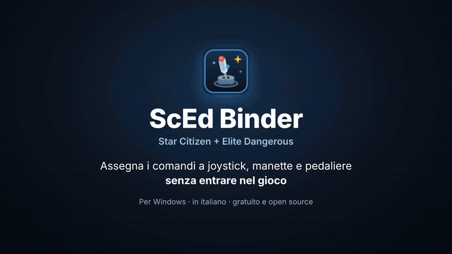

# ScEd Binder

**ScEd** = **S**tar **C**itizen + **E**lite **D**angerous.

Assegna i comandi di **Star Citizen** e di **Elite Dangerous** a joystick, manette, pedali, volanti, gamepad, tastiera e mouse **senza entrare nel gioco**. Interfaccia e comandi in italiano.

*Bind Star Citizen and Elite Dangerous controls to all your devices without launching the game. Italian UI and Italian command names (English names shown alongside).*

## Video dimostrativo



Un minuto e mezzo, senza audio: rilevamento delle periferiche, schema con i tasti, assegnazione dei comandi, anteprima 3D, numerazione automatica, layout, scrittura nel gioco ed Elite Dangerous. Versione in alta definizione: [`docs/ScEd_Binder_demo.mp4`](docs/ScEd_Binder_demo.mp4). Il video è girato con periferiche simulate.

Per **Elite Dangerous** (dalla versione 3.0, ancora da collaudare in gioco) gestisce joystick, manette e pedaliere; tastiera e mouse vengono conservati ma non modificati. Fino alla versione 3.1 il programma si chiamava *SC Binding*.

## Cosa fa
- Rileva le periferiche collegate (DirectInput per joystick/manette/pedali/volanti, XInput per i gamepad).
- Mostra lo schema della periferica con i tasti: premi un tasto vero e la casella si illumina.
- 60 modelli con foto e mappa dei comandi (VKB, Virpil, Thrustmaster, Logitech, WinCtrl/WINWING, MOZA, Honeycomb, MFG e pedaliere) più 45 schemi disegnati; per le altre periferiche carichi una foto e posizioni le etichette, e puoi esportare/importare lo schema per condividerlo. Dove il numero di un tasto non è noto, l'app lo impara: clicchi la riga e premi il tasto.
- Tutti i comandi assegnabili tradotti in italiano.
- Inversione degli assi, ingressi da ignorare, doppio tocco, più comandi sullo stesso tasto.
- Anteprima 3D dei movimenti della nave.
- Scrive `actionmaps.xml` nella cartella del gioco (con copia di sicurezza).
- Le assegnazioni sono legate alla periferica, non al numero `jsN`: se aggiungi o togli una periferica la numerazione viene ricalcolata.
- Aggiornamento automatico: all'avvio controlla l'ultima versione pubblicata qui su GitHub, scarica il nuovo `.exe` accanto a quello in uso, ne verifica l'impronta SHA-256 e passa alla nuova versione (si disattiva dalle Opzioni).

## Uso
Scarica `ScEd_Binder_vX.Y.exe` dalla pagina [Releases](https://github.com/Toskurim/ScEd-Binder/releases) e avvialo (Windows 10/11 a 64 bit). Si apre una finestra dell'app (usa Microsoft Edge o Chrome come finestra, non serve Internet). I dati stanno nella cartella `dati` accanto al programma.

## Compilazione
Serve solo [Go](https://go.dev) 1.24 o superiore, nessuna dipendenza esterna.

```
go build -ldflags "-H=windowsgui -s -w" -o ScEd_Binder.exe .
```
Su Linux/macOS `go build` produce una versione di prova con periferiche simulate.

L'icona è in `rsrc_windows_amd64.syso` (generata da `tools/icon/mkres.py`) e viene inclusa da sola nella compilazione per Windows.

`mkdata.py` rigenera `data/` (etichette italiane/inglesi) partendo da un `defaultProfile.xml` e dai `global.ini` del gioco.

## Stato
Progetto amatoriale. La lettura delle periferiche e la scrittura del file sono state provate su una sola configurazione: segnala i problemi allegando il testo di "⋯ > Diagnostica periferiche".

## Licenza e crediti
Codice: **GNU GPL v2** (vedi `LICENSE`). Materiale di terzi, comprese le foto dei prodotti che NON sono sotto GPL: vedi `NOTICE.md`.

Questo è uno strumento non ufficiale per Star Citizen ed Elite Dangerous, non affiliato a Cloud Imperium né a Frontier Developments. Star Citizen®, Roberts Space Industries® e Cloud Imperium® sono marchi registrati di Cloud Imperium Rights LLC. Elite Dangerous è un marchio di Frontier Developments plc.
